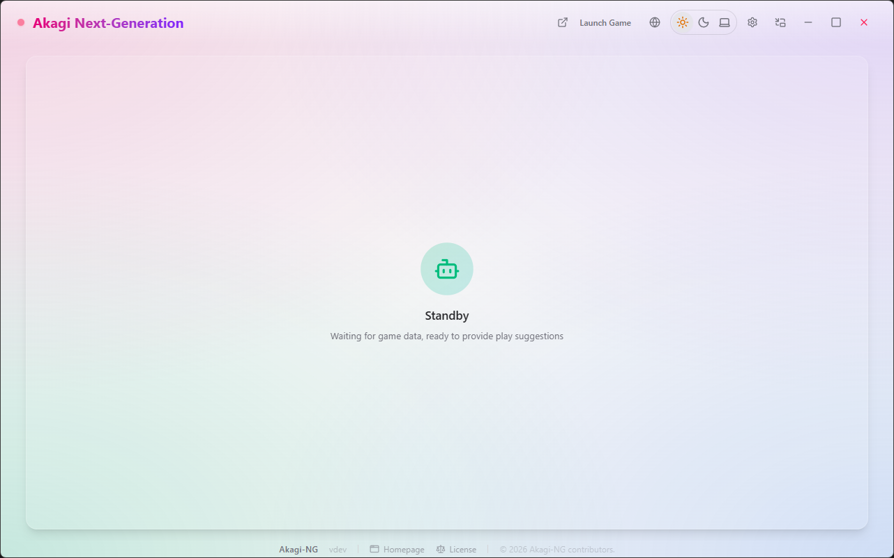
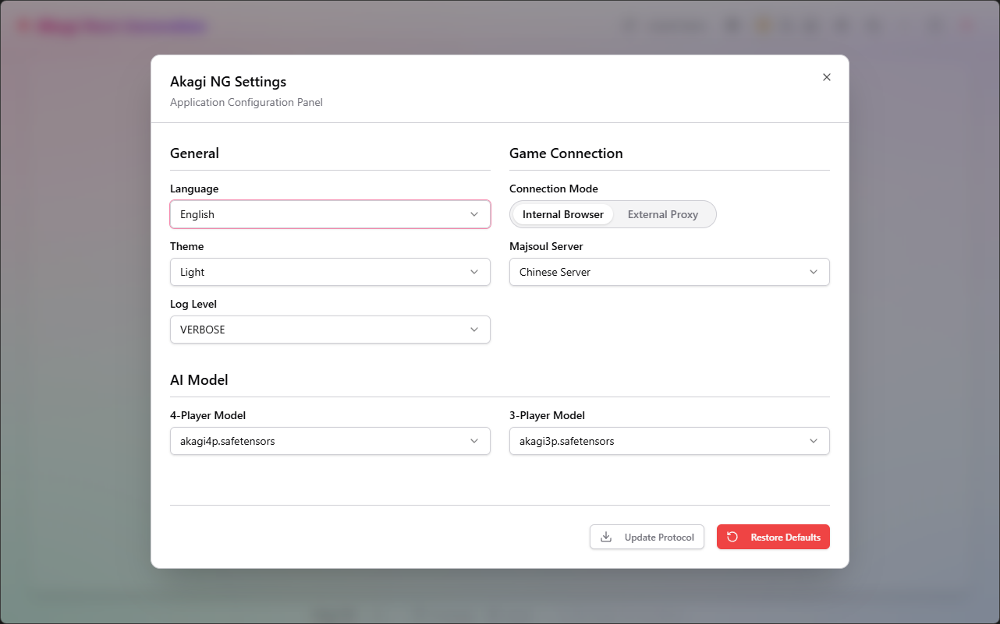

<div align="center">
  
  <h1>Akagi-NG</h1>

  <p>
    Next Generation Mahjong AI Assistant<br>
    Inspired by <b>Akagi</b> and <b>MajsoulHelper</b>
  </p>
<p><i>「死ねば助かるのに……」— 赤木しげる</i></p>

<p>
<a href="https://github.com/Xe-Persistent/Akagi-NG/actions/workflows/test.yml"></a>
<a href="https://github.com/Xe-Persistent/Akagi-NG/releases"></a>
<a href="https://github.com/Xe-Persistent/Akagi-NG/stargazers"></a>
<br>


<br>


<br>

<a href="https://discord.gg/Z2wjXUK8bN"></a>
<a href="https://codecov.io/gh/Xe-Persistent/Akagi-NG"></a>
</p>

<p align="center">
  <a href="./README_ZH.md">简体中文</a> | <b>English</b>
</p>
</div>

---

## What is Akagi-NG?

**Akagi-NG** is the next-generation rewrite of the original [Akagi](https://github.com/shinkuan/Akagi) project.

It is an AI-powered assistant designed for Japanese Mahjong (Riichi Mahjong), aimed at providing real-time situation analysis and decision recommendations for online Mahjong games.

Core Philosophy of Akagi-NG:

- **Modern Architecture Practices**: Fully embrace Electron, React 19 and TS 6.0, constructing a stable, smooth and high-performance system foundation with cutting-edge engineering standards.
- **Ultimate Inference Performance**: Deeply integrate with the high-speed Rust inference engine, providing full-speed, libriichi-free inference for the built-in Akagi models.
- **Deeply Decoupled Design**: Highly decouple the decision core and interaction system, providing built-in browser mode and MITM proxy mode, flexibly adapting to various usage environments.

---

## Features

- 🖥️ **Compatible Platforms**
  - Windows 10 & 11
  - macOS 13 Ventura or later (Apple Silicon only)
  - Linux

- 🎮 **Supported Games**
  - Mahjong Soul

- 🀄 **Supported Modes**
  - Standard 4-player and 3-player riichi
  - Battle of Asura (修罗之战)

- ✨ **Core Features**
  - Real-time hand analysis and AI discard recommendations
  - Riichi Lookahead - intelligently recommends the best discard after declaring riichi
  - Comprehensive Fuuro Support - Clear action prompts for Chi, Pon and all Kan variants
  - Modern Glassmorphism Style - Smooth and transparent visual experience
  - Multi-language support - Simplified Chinese / Traditional Chinese / Japanese / English

- 🤖 **AI Models**
  - Akagi (built-in 4p / 3p models)

## Demo

https://github.com/user-attachments/assets/b15d1f76-3009-448d-9648-0d2ffd4f3b7e

## Screenshots

### Main Interface



### Settings Panel



---

## Disclaimer

> [!CAUTION]
> This project is for **educational and research purposes only**.
>
> Using third-party auxiliary tools in online games may violate the game's Terms of Service.
> The authors and contributors of Akagi-NG are **NOT responsible for any consequences**, including but not limited to **account bans or suspensions**.
>
> Please fully understand and assume the relevant risks before use.

## Usage Guide

### 1. Quick Start

1. **Download**: Go to [Releases](../../releases) and download the latest Release package for your platform and complete the installation/extraction.
2. **Run**: Double-click to run `Akagi-NG`.
3. **Play**: Click "**Launch Game**" in the Dashboard, click the monitor icon in the top right corner to open the **HUD**.

### 2. Directory Structure

To ensure the program runs correctly, please check if the `Akagi-NG` directory structure is complete:

```plain
Akagi-NG/
  ├── Akagi-NG     # Main Application (Electron Desktop)
  ├── assets/      # Platform-specific UI assets
  ├── ca/          # MITM CA certificate (created when the proxy is enabled)
  ├── config/      # Configuration directory (settings.json)
  ├── locales/     # Localization resource files
  ├── logs/        # Runtime log directory
  ├── models/      # AI model weight files (.safetensors)
  │     ├── akagi4p
  │     └── akagi3p
  ├── resources/   # Electron core resources (app.asar)
  ├── LICENSE      # Open source license
  ├── README       # Quick start plain text guide
  └── ...          # Other runtime files (.dll, .pak, etc.)
```

### 3. Start and Exit

After double-clicking `Akagi-NG`, the program will show the integrated Dashboard main panel. You can directly click "Launch Game" in the Dashboard to launch the game browser window.

Click the monitor icon in the top right corner of the Dashboard to open the HUD interface. Click the × in the top right corner of the Dashboard to minimize the program to the system tray. To exit the program, right-click the tray icon and select "Quit Akagi-NG".

> [!NOTE]
> macOS builds are unsigned and not notarized. On first launch, right-click `Akagi-NG.app` and choose **Open**, or allow it in **System Settings → Privacy & Security**. If macOS still blocks it, run `xattr -dr com.apple.quarantine /Applications/Akagi-NG.app`.

> [!TIP]
> **HUD (Heads-Up Display)** is a core feature of Akagi-NG. It can directly overlay auxiliary information in a semi-transparent form over the game screen, without the need to manually pin windows to the top.

### 4. Configuration

All configurations for Akagi-NG are located in the `config/settings.json` file. You can enter the configuration panel by clicking the gear icon in the top right corner of the Dashboard to adjust program behavior.

### 5. Built-in Browser Mode

This is the **default working mode** for Akagi-NG. In this mode, Akagi-NG uses the Electron core to manage a dedicated Chromium instance to run the game.

#### Core Advantages

- **Zero Configuration**: No certificate or proxy settings required.
- **Environment Isolation**: Completely isolated from the browser you use daily.
- **Safe and Stable**: Receives data directly from the game server with high stability.

#### Usage Method

1. Run `Akagi-NG`.
2. Click "Launch Game" in the Dashboard.

### 6. MITM External Proxy Mode

Akagi-NG supports intercepting game data via Man-in-the-Middle (MITM) attacks, allowing you to use any browser, game client or mobile device (with proxy) for matches.

#### Usage Method

1. Enable "External Proxy" in the settings panel.

2. Import and trust the CA certificate generated by Akagi-NG (it is created automatically the first time you enable the proxy). On Windows:
   1. Double-click `akagi-ng-ca.cer`, then click `Install Certificate`
   2. Select `Current User`, then click Next
   3. Select `Place all certificates in the following store`, then click `Browse...`
   4. Select `Trusted Root Certification Authorities`, click OK, then Next and Finish
   5. If prompted for permission, click `Yes`

> [!NOTE]
> The built-in window uses capture through Electron's debugger, so it needs no certificate. The certificate is only required for an external browser or game client routed to the proxy.

3. Akagi-NG starts an HTTP proxy server at `127.0.0.1:6789` by default. You can click "Launch Game" in the Dashboard to start playing directly — in this case, Akagi-NG works similarly to Built-in Browser Mode. If you wish to use a system browser or game client, you will also need to configure proxy software and routing rules to direct game-related traffic to this proxy.

> [!IMPORTANT]
> For processes like the Steam game client, you must enable TUN / Enhanced Mode in your proxy software to ensure process traffic passes through Akagi-NG. Also be careful to avoid loopback proxying — make sure traffic originating from Akagi-NG is not routed back to itself.
>
> For browser, configuring the system proxy and domain rules is enough. TUN / Enhanced Mode is usually not required.

<details>
<summary><b>Click to view detailed proxy configuration</b></summary>

#### Configuration Scheme A: Browser Web Version (SwitchyOmega Proxy, using Mahjong Soul as an example)

**Configuration Steps**:

1. **Prepare Environment**:
   - Ensure Akagi-NG is started and `mitm.enabled` is `true` (port defaults to 6789).
   - Chrome/Edge users: search for **SwitchyOmega** in the browser extension store and install it.

2. **Configure Profile**:
   - Open SwitchyOmega settings interface.
   - Click **New profile** on the left -> Name it `Akagi-Mitm` -> Select type **Proxy Profile**.
   - In the settings of `Akagi-Mitm`, fill in:
     - Protocol: `HTTP`
     - Server: `127.0.0.1`
     - Port: `6789`
   - Click **Apply Changes** on the left to save.

3. **Configure Auto Switch**:
   - Click **Auto switch** on the left.
   - Delete all existing rules (if any).
   - **Add rules**:
     - Domain wildcard: `*.maj-soul.com  ->  Akagi-Mitm`
     - Domain wildcard: `*.majsoul.com  ->  Akagi-Mitm`
     - Domain wildcard: `*.mahjongsoul.com  ->  Akagi-Mitm`
   - **Default rule**:
     - Select **[System Proxy]**, then click **Apply Changes** to save.

4. **Start Game**:
   - Click the SwitchyOmega extension icon in the top right corner of the browser, select **Auto switch**.
   - Visit Mahjong Soul web version, Akagi-NG should be able to receive game traffic.

#### Configuration Scheme B: Steam Game Client (Clash Rule Proxy, using Windows, Clash Verge rev as an example)

> When playing with the Steam client, please ensure Clash is in TUN mode, otherwise client traffic cannot be proxied.

1. **Find Configuration Entry**:
   - In the Clash Verge rev client, click "Profiles" on the left, find your configuration file or create a new configuration.

2. **Add Proxy Node (Proxies)**:
   - Define a node pointing to the local Akagi-NG proxy.

   ```yaml
   proxies:
     - name: Akagi-Mitm
       type: http
       server: 127.0.0.1
       port: 6789
       tls: false
   ```

   - You can also define a proxy group (Proxy-groups) containing the local proxy node and Direct, making it convenient to toggle whether to use the Akagi-NG local proxy.

   ```yaml
   proxy-groups:
     - name: 🀄 Mahjong Soul
       proxies:
         - Akagi-Mitm
         - DIRECT
       type: select
   ```

3. **Add Routing Rules (Rules)**:
   - Using Mahjong Soul as an example, route Mahjong Soul related domains to the node defined above. Please note the rule order, it is recommended to place them near the top.

   ```yaml
   rules:
     # This rule MUST be placed first to avoid loopback proxying
     - PROCESS-NAME,akagi-ng.exe,DIRECT
     # Steam client
     - PROCESS-NAME,Jantama_MahjongSoul.exe,🀄 Mahjong Soul
     # Browser
     - DOMAIN-KEYWORD,maj-soul,🀄 Mahjong Soul
     - DOMAIN-KEYWORD,majsoul,🀄 Mahjong Soul
     - DOMAIN-KEYWORD,mahjongsoul,🀄 Mahjong Soul
   ```

4. **Apply Configuration**:
   - Save and refresh the Clash configuration. Now start the Mahjong Soul client, the traffic path is: `Mahjong Soul Client -> Clash (TUN) -> Matches Rules -> Forward to Akagi-NG (6789) -> Your Network/Upstream Proxy`

</details>

---

## FAQ

#### Q: How is the strength of the built-in models?

**A:** Taking Mahjong Soul as an example, the built-in Akagi 4p model is around Master 1, and the 3p model is comparable.

#### Q: Is the model strength different in Battle of Asura mode?

**A:** The model is trained on standard riichi rules. Under Battle of Asura scoring — where winning earlier is worth more, a self-draw pays less after someone has won, and at most three players can win — its _choices_ do not fully represent the model's strength, while the layer below is exact: legal actions, your hand, event flow and settlement all follow the game.

#### Q: Is there an autoplay feature?

**A:** Currently, Akagi-NG does not support autoplay.

---

## Source Code Build Guide

### Environment Requirements

- **Node.js 24 & npm**: Used to compile the Electron desktop, React frontend and application tooling.
- **Rust toolchain**: Used to build the native inference engine (`packages/rust_engine`).
- **Git**: Used to clone the project repository.

### 1. Initialize Project

Clone the repository and enter the directory:

```bash
git clone https://github.com/Xe-Persistent/Akagi-NG.git
cd Akagi-NG
```

#### Install Dependencies

In the project root, run install:

```bash
npm install
```

#### Build the Rust Inference Engine

The main process loads the native engine through a Node-API binding. Build it once before running in development:

```bash
npm run build -w @akagi-ng/rust-engine
```

This command also regenerates the Node-API loader (`index.js`) and its type declarations (`index.d.ts`) inside `packages/rust_engine/native`.

### 2. Run in Development

Launch the mono-repo development environment:

```bash
npm run dev
```

If you just want to inspect the HUD without starting a game or loading a model:

```bash
npm run dev:mock
```

This plays a rotating set of canned recommendations (data in `packages/main/src/mock-data.ts`)
and walks the status indicator through every state it can show, so you can inspect the
recommendation shapes and indicator states one by one.

### 3. Build for Production

Clean, sync versions, build the Rust inference engine, compile and package the entire application:

```bash
npm run build
```

The build artifacts will be generated in the `dist/release` directory.

### 4. Updating the Majsoul Protocol

The `assets/liqi.json` descriptor is rebuilt from the Mahjong Soul Unity client. See
[docs/PROTOCOL.md](docs/PROTOCOL.md) for the extraction commands and the `Auto Liqi` workflow.

---

## Open Source License

The core source code of this software follows the [GNU Affero General Public License version 3 (AGPLv3)](LICENSE) open source protocol.

## Acknowledgements & Third-Party Resources

The inference engine in `packages/rust_engine` reuses the model decoder, observation encoder, action codec and MJAI compatibility layer of [shinkuan/Akagi](https://github.com/shinkuan/Akagi)'s `native_bot`, and is covered by the same parity tests, so the bundled weights produce identical decisions here and upstream.

The `models` AI weight files bundled with releases come from the default `native_bot` weights in [shinkuan/Akagi](https://github.com/shinkuan/Akagi) (`native_bot/weights/akagi4p.safetensors` and `akagi3p.safetensors`).

These resources are distributed under the Apache-2.0 license. Copyright belongs to the original authors. We extend our greatest gratitude for their work.
