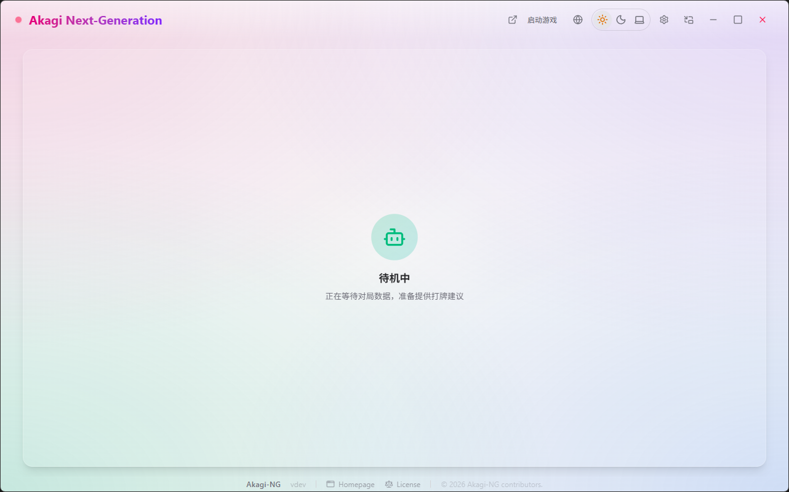
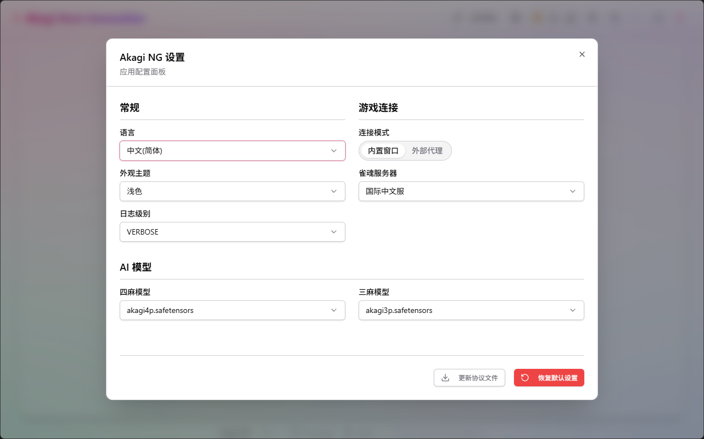

<div align="center">
  
  <h1>Akagi-NG</h1>

  <p>
    Next Generation Mahjong AI Assistant<br>
    Inspired by <b>Akagi</b> and <b>MajsoulHelper</b>
  </p>
<p><i>「死ねば助かるのに……」— 赤木しげる</i></p>

<p>
<a href="https://github.com/Xe-Persistent/Akagi-NG/actions/workflows/test.yml"></a>
<a href="https://github.com/Xe-Persistent/Akagi-NG/releases"></a>
<a href="https://github.com/Xe-Persistent/Akagi-NG/stargazers"></a>
<br>


<br>


<br>

<a href="https://discord.gg/Z2wjXUK8bN"></a>
<a href="https://codecov.io/gh/Xe-Persistent/Akagi-NG"></a>
</p>

<p align="center">
  <b>简体中文</b> | <a href="./README.md">English</a>
</p>
</div>

---

## 什么是 Akagi-NG？

**Akagi-NG** 是原 [Akagi](https://github.com/shinkuan/Akagi) 项目的次世代版本。

这是一款专为日本麻将（立直麻将）设计的 AI 辅助工具，旨在为线上麻将游戏对局提供实时局势分析与决策建议。

Akagi-NG 的核心理念：

- **前沿架构实践**：全面拥抱 Electron、React 19 与 TS 6.0，以前沿工程标准构筑稳固、丝滑且高性能的系统基石。
- **极致性能推理**：深度集成 Rust 高速推理引擎，无需 `libriichi` 即可为内置 Akagi 模型提供全速推理能力。
- **深度解耦设计**：决策核心与交互系统高度解耦，提供内置浏览器模式与 MITM 代理模式，灵活适配各类使用环境。

---

## 功能特性

- 🖥️ **兼容平台**
  - Windows 10 & 11
  - macOS 13 Ventura 及以上（仅 Apple Silicon）
  - Linux

- 🎮 **支持游戏**
  - 雀魂麻将

- 🀄 **支持模式**
  - 标准四人麻将 / 三人麻将
  - 修罗之战

- ✨ **核心功能**
  - 实时手牌分析与 AI 何切推荐
  - 立直前瞻 - 智能推荐最佳立直舍牌
  - 完整的副露支持 - 吃/碰/杠操作提示一目了然
  - 全新毛玻璃风格界面 - 丝滑且通透的视觉体验
  - 多语言支持 - 简体中文 / 繁體中文 / 日本語 / English

- 🤖 **AI 模型**
  - MJOT 云端推理
  - 内置四麻 / 三麻模型

## 演示视频

https://github.com/user-attachments/assets/701a3dcf-1574-46af-9594-082605c4e158

## 运行截图

### 主界面



### 设置面板



---

## 免责声明

> [!CAUTION]
> 本项目**仅供教育及研究使用**。
>
> 在网络游戏中使用第三方辅助工具可能违反游戏的服务条款。
> Akagi-NG 的作者及贡献者**不对任何使用后果负责**，包括但不限于**账号被封禁或冻结**。
>
> 请您在使用前充分了解并自行承担相关风险。

## 使用指南

### 1. 快速开始

1. **下载**: 前往 [Releases](../../releases) 下载对应平台的最新版本 Release 产物并完成安装/解压。
2. **运行**: 双击运行 `Akagi-NG`。
3. **对局**: 在 Dashboard 中点击“**启动游戏**”，点击右上角显示器图标开启 **HUD**。

### 2. 目录结构说明

为了确保程序正常运行，请检查 `Akagi-NG` 所在目录结构是否完整：

```plain
Akagi-NG/
  ├── Akagi-NG     # 主程序 (Electron 桌面端)
  ├── assets/      # 各平台相关的界面资源
  ├── ca/          # MITM CA 证书（启用代理时生成）
  ├── config/      # 配置文件目录 (settings.json)
  ├── locales/     # 多语言支持资源
  ├── logs/        # 运行日志目录
  ├── models/      # AI 模型权重文件 (.safetensors)
  │     ├── akagi4p
  │     └── akagi3p
  ├── resources/   # 应用程序核心资源 (app.asar)
  ├── LICENSE      # 开源许可协议
  ├── README       # 极简使用说明
  └── ...          # 其他必要的运行时支持文件 (.dll, .pak 等)
```

### 3. 启动与退出

双击运行 `Akagi-NG` 后，程序将展示集成化的 Dashboard 主面板。您可以直接点击 Dashboard 中的“启动游戏”打开游戏浏览器窗口。

点击 Dashboard 右上角的显示器图标即可开启 HUD 界面。点击 Dashboard 右上角的 × 会将程序最小化至系统托盘。如需退出程序，请点击托盘右键菜单的 “Quit Akagi-NG”。

> [!NOTE]
> macOS 构建未签名、未公证。首次启动请右键点击 `Akagi-NG.app` 选择“打开”，或在“系统设置 → 隐私与安全性”中允许运行；若仍被拦截，可执行 `xattr -dr com.apple.quarantine /Applications/Akagi-NG.app`。

> [!TIP]
> **HUD (Heads-Up Display)** 是 Akagi-NG 的一项核心特性。它能够将辅助信息直接以半透明形式覆盖在游戏画面上，无需手动置顶窗口。

### 4. 配置

Akagi-NG 的所有配置均位于 `config/settings.json` 文件中。您可以点击 Dashboard 右上角的齿轮图标进入设置面板来调整程序行为。

### 5. 内置浏览器模式

这是 Akagi-NG 的**默认工作模式**。在此模式下，Akagi-NG 利用 Electron 核心管理一个专用的 Chromium 实例来运行游戏。

#### 核心优势

- **免配置**：无需证书或代理设置，一键启动。
- **环境隔离**：与您日常使用的浏览器完全隔离，互不干扰。
- **安全稳定**：直接从游戏服务器接收数据，稳定性高。

#### 使用方法

1. 运行 `Akagi-NG`。
2. 在 Dashboard 中点击“启动游戏”。

### 6. MITM 外部代理模式

Akagi-NG 支持通过中间人攻击 (MITM) 方式截获游戏数据，这允许您使用任意浏览器、游戏客户端或移动设备（配合代理）进行对局。

#### 使用方法

1. 在设置面板中启用“外部代理”。

2. 在系统中导入并信任 Akagi-NG 生成的 CA 证书（首次启用代理时会自动生成），以 Windows 为例：
   1. 双击 `akagi-ng-ca.cer`，点击 `安装证书` 按钮
   2. 选择 `当前用户`，然后点击下一步
   3. 选择 `将所有证书放入下列存储`，然后点击 `浏览...`
   4. 选择 `受信任的根证书颁发机构`，确定，再点击下一步、完成
   5. 若提示要求权限，请选择 `是`

> [!NOTE]
> 内置窗口通过 Electron 调试协议抓包，本身不需要证书；只有使用外部浏览器或游戏客户端时才需要安装。

3. Akagi-NG 默认在本地 127.0.0.1:6789 启动一个 HTTP 代理服务器。您可以选择直接在 Dashboard 中点击“启动游戏”开始游玩，此时 Akagi-NG 的工作方式与内置浏览器模式类似。如果您希望使用系统浏览器或游戏客户端，还需配合代理软件与代理规则将游戏相关流量导向该代理。

> [!IMPORTANT]
> Steam 游戏客户端等进程需要在代理软件中开启 TUN / 增强模式，才能保证进程流量经过 Akagi-NG；此外还须注意避免回环代理，即确保从 Akagi-NG 发出的流量不会被导向自身。
>
> 浏览器网页端一般只需配置系统代理和域名规则即可，通常不需要开启 TUN / 增强模式。

<details>
<summary><b>点击查看详细代理规则配置方案</b></summary>

#### 配置方案 A: 浏览器网页（SwitchyOmega 代理，以雀魂麻将为例）

**配置步骤**：

1. **准备环境**：
   - 确保 Akagi-NG 已启动且 `mitm.enabled` 为 `true`（端口默认为 6789）。
   - Chrome/Edge 用户请在浏览器扩展商店搜索并安装 **SwitchyOmega**。

2. **配置情景模式**:
   - 打开 SwitchyOmega 设置界面。
   - 点击左侧 **新建情景模式** -> 命名为 `Akagi-Mitm` -> 类型选择 **代理服务器**。
   - 在 `Akagi-Mitm` 的设置中填写：
     - 协议：`HTTP`
     - 服务器：`127.0.0.1`
     - 端口：`6789`
   - 点击左侧 **应用选项** 保存。

3. **配置自动切换**:
   - 点击左侧 **自动切换** (auto switch)。
   - 删除所有现有规则（如果有）。
   - **添加规则**：
     - 域名通配符：`*.maj-soul.com  ->  Akagi-Mitm`
     - 域名通配符：`*.majsoul.com  ->  Akagi-Mitm`
     - 域名通配符：`*.mahjongsoul.com  ->  Akagi-Mitm`
     - 域名通配符：`*.log.aliyuncs.com  ->  Akagi-Mitm`
     - 域名：`mahjongsoul.game.yo-star.com  ->  Akagi-Mitm`
   - **默认规则**：
     - 选择 **[系统代理]**，然后点击 **应用选项** 保存。

4. **开始游戏**:
   - 点击浏览器右上角 SwitchyOmega 扩展程序的图标，选择 **自动切换**。
   - 此时访问雀魂网页版，Akagi-NG 应能正常截获游戏流量。

#### 配置方案 B: Steam 游戏客户端（Clash 规则代理，以 Windows 平台、Clash Verge rev为例）

> 使用 Steam 客户端游玩时，请确保 Clash 处在 TUN 模式下，否则将无法代理客户端流量

1. **找到配置入口**:
   - 在 Clash Verge rev 客户端左侧点击“订阅”，找到您的配置文件，或者新建一个配置。

2. **添加代理节点 (Proxies)**:
   - 定义一个指向 Akagi-NG 本地代理的节点。

   ```yaml
   proxies:
     - name: Akagi-Mitm
       type: http
       server: 127.0.0.1
       port: 6789
       tls: false
   ```

   - 还可以定义一个代理组 (Proxy-groups)，里面包含本地代理节点和直连 (Direct)，这样方便切换是否使用 Akagi-NG 本地代理。

   ```yaml
   proxy-groups:
     - name: 🀄 雀魂麻将
       proxies:
         - Akagi-Mitm
         - DIRECT
       type: select
   ```

3. **添加路由规则 (Rules)**:
   - 以雀魂麻将为例，将雀魂相关域名指向上面定义的本地代理节点。请注意规则顺序，建议将规则放在靠前位置。

   ```yaml
   rules:
     # 这一条必须放在最前面，否则会导致回环代理
     - PROCESS-NAME,akagi-ng.exe,DIRECT
     # 客户端 / Steam
     - PROCESS-NAME,Jantama_MahjongSoul.exe,🀄 雀魂麻将
     # 网页端
     - DOMAIN-KEYWORD,maj-soul,🀄 雀魂麻将
     - DOMAIN-KEYWORD,majsoul,🀄 雀魂麻将
     - DOMAIN-KEYWORD,mahjongsoul,🀄 雀魂麻将
   ```

4. **应用配置**:
   - 保存并刷新 Clash 配置。现在启动雀魂客户端，流量路径为：`雀魂客户端 -> Clash (TUN) -> 匹配到 Rules -> 转发给 Akagi-NG (6789) -> 您的网络/上游代理`

</details>

---

## 常见问题

#### Q: 内置的模型强度如何？

**A:** 以雀魂为例，内置的 Akagi 四麻模型水平约在雀豪1，三麻模型与四麻相近。

#### Q: 修罗之战的模型强度与普通模式有区别吗？

**A:** 模型是按标准立直麻将规则训练的。在血战的算分方式下（早巡和牌收益更高、有人和牌后自摸损、最多只有三家和牌），它的*选择*不能完全代表该模型的水平，而底层的*正确性*是有保证的：合法动作、手牌、事件流、结算都与游戏一致。

#### Q: 有没有自动打牌功能？

**A:** 很遗憾，Akagi-NG 暂不支持自动打牌功能。

---

## 源码构建指南

### 环境要求

- **Node.js 24 & npm**: 用于编译 Electron 桌面端、React 前端与各类构建脚本。
- **Rust 工具链**: 用于构建原生推理引擎（`packages/rust_engine`）。
- **Git**: 用于克隆项目仓库。

### 1. 项目初始化

克隆仓库并进入根目录：

```bash
git clone https://github.com/Xe-Persistent/Akagi-NG.git
cd Akagi-NG
```

#### 安装依赖

在项目根目录下，执行安装：

```bash
npm install
```

#### 构建 Rust 推理引擎

主进程通过 Node-API 原生扩展加载推理引擎，开发前需先构建一次：

```bash
npm run build -w @akagi-ng/rust-engine
```

该命令同时会重新生成 `packages/rust_engine/native` 下的 Node-API 加载器（`index.js`）与类型声明（`index.d.ts`）。

### 2. 开发环境运行

在项目根目录下执行一键启动命令，会同时拉起前端和 Electron 端：

```bash
npm run dev
```

如果只是想看 HUD 的显示效果（不需要开一局、也不需要模型）：

```bash
npm run dev:mock
```

会循环播放一组预设的打牌建议，并把状态指示器可能出现的所有状态依次走一遍，方便逐个检查建议形态与指示器状态。

### 3. 生产环境构建

执行以下命令，即可一键完成环境清理、版本号同步、Rust 推理引擎构建、前端打包以及应用最终打包的全流程：

```bash
npm run build
```

构建产物将生成于 `dist/release` 目录下。

### 4. 更新雀魂协议

`assets/liqi.json` 描述符直接从雀魂 Unity 客户端重建。提取命令与 `Auto Liqi` 工作流见
[docs/PROTOCOL.md](docs/PROTOCOL.md)。

---

## 开源协议

本软件的主体代码遵循 [GNU Affero General Public License version 3 (AGPLv3)](LICENSE) 开源协议。

## 致谢与第三方资源声明

本项目的 `packages/rust_engine` 推理引擎复用了 [shinkuan/Akagi](https://github.com/shinkuan/Akagi) `native_bot` 的模型解码器、观测编码、动作编解码与 MJAI 兼容层，并沿用其对齐测试，以保证内置权重在本项目与上游产生完全一致的决策。

本项目发布版打包附带的 `models` AI 模型权重文件来源于 [shinkuan/Akagi](https://github.com/shinkuan/Akagi) 的默认 `native_bot` 权重（`native_bot/weights/akagi4p.safetensors` 与 `akagi3p.safetensors`）。

以上资源以 Apache-2.0 许可分发。版权归原作者所有。在此向原作者的卓越工作与开源精神表示最诚挚的感谢！
